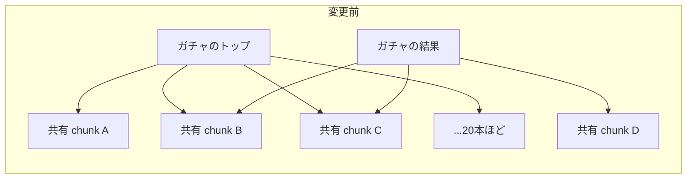
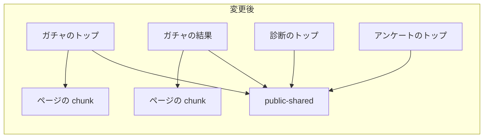

## はじめに
こんにちは！添田です！

弊社のプロダクト「クロワッサン」で、公開ページが読み込むファイルの数を減らす対応をしました。
webpackの`splitChunks`に設定を1つ足して、バラバラだった共有コードを1本にまとめたところ、
ガチャを1回遊ぶ間に読むファイル（chunk）が**48本 → 16本**になりました！

設定自体は20行ほどです。
この記事では、何をまとめて何をまとめないか、そのかわりに何が重くなるかなど、設計で決めたことを書いていきます。

## 何に困っていたか
クロワッサンは、ガチャ・診断・アンケートを作って配信できるサービスです。
エンドユーザーが遊ぶ公開ページはNext.js（Pages Router）で作っていて、
ガチャなら「トップ → 抽選中 → 結果」のように画面を移っていきます。

### CloudFrontの定額プランの枠
本番のCloudFrontは、定額プランを使っています。
移行したときの話は、弊社CTOの記事にまとまっています。

https://zenn.dev/onthebakery/articles/71a5508f378118

この記事の最後に、リクエスト数の削減施策を検討すると書いてあります。
今回の対応は、その削減施策の1つです！

定額プランの枠はリクエスト数と転送量の2つあり、
調査を始めた9月下旬には、このうちリクエスト数が枠を超えていました。

| | リクエスト数 |
| --- | --- |
| プランの枠 | 月125M |
| 調査を始めた9月下旬の実績を月に換算した値 | 約166M（枠の133%） |

- 超えても追加料金はかからない
- ただ、大きく超え続けると、配信の性能を下げられることがある（エッジロケーションを減らされるなど）
- 1つ上のプランにすると、少なくとも月$800高くなる

中身を調べると、リクエストの約4割が`/_next/static/`（Next.jsがビルドしたJS・CSS）でした。
手元のビルドをブラウザで遊んで数えてみると、ガチャを1回遊ぶ間に48本のファイルを取りに行っていました。

まずはこの本数を減らして、枠に近づけることにしました。

### 速くするための変更ではない
一般に、HTTP/2では1本の接続で複数のファイルを同時に取れるので、
本数が多くても表示の速さにはあまり響かないと言われています。
実際、試作で回線を絞らずに測ったところ、本数が減っても表示の時間は変わりませんでした（差は±7ms）。

それでも本数を減らしたのは、CloudFrontの枠が「リクエストの本数」で数えられるからです。
1本が1KBでも200KBでも、同じ1リクエストとして枠を使います。
なので今回は、読む量や表示の速さより、本数を減らすことを優先しました。

## なんでこんなに本数が多いの？
Next.jsのビルドの設定を読んで調べました。

Next.js（webpackでビルドする場合）は、クライアント向けのJSを次のように分けています。

| chunk | 中身 |
| --- | --- |
| `framework` | Reactなど、フレームワークのコード |
| `lib`のchunk | `node_modules`の中の、1ファイルで160KB（圧縮前）を超えるモジュールを1つずつ |
| 共有のchunk | 複数のページで使うコードや`node_modules`のコードを、使うページの組み合わせごとに分けたもの（webpackの既定の`default` / `defaultVendors`グループ） |
| ページのchunk | そのページだけで使うコード |

ポイントは3つ目の共有のchunkです！
「ガチャのトップと結果で使うコード」「ガチャのトップと診断のトップで使うコード」のように、
使うページの組み合わせごとに別のファイルになります。

Next.jsは、1ページで最初に読める本数の上限（`maxInitialRequests`）を25本にしています。
ページによっては、この上限の中で細かいchunkが20本ほどに分かれていました。
なお、この上限はページ自身の分だけで、`_app`など全ページ共通のファイルは別に数えます。



画面を移るたびに、まだ読んでいない共有のchunkを少しずつ取りに行くので、
1回遊ぶ間の合計が48本になっていました。

細かく分けるのは、ページごとに必要なコードだけを読むためです。
読む量（KB）を減らすには良い分け方なのですが、今回減らしたいのはリクエストの「本数」でした。

## ほかに考えた案
いきなり今の形に決めたわけではなく、ほかの案も比べました。

| 案 | 良いところ | 気になるところ |
| --- | --- | --- |
| chunkの最小サイズ（`minSize`）を100KBに上げる | 1行の変更で手軽 | 調査のときに試すと、ビルドの結果で数えて約30本で、目的に足りなかった |
| 公開ページの共有コードを1本にまとめる（採用） | ビルドの結果で数えると46本 → 14本まで減る | 最初のページで読む量が増える |

`minSize`を上げる案は手軽で魅力的だったのですが、
細かいchunkがいくつかまとまるだけで、「使うページの組み合わせごとに分かれる」仕組みはそのまま残ります。
本数を大きく減らすには、分け方そのものを変える必要がありました。

## やったこと
公開ページ（ガチャ・診断・アンケート・LINEのミニアプリ）で共有しているコードを、
`public-shared`という1本のchunkにまとめました。

`next.config.js`の`webpack`の設定で、`config.optimization.splitChunks.cacheGroups`に公開ページ用のグループを1つ足しています。
CSSとミニアプリ専用のコードは集めない条件も入れています（後述）。

形としては、次のような設定です（考え方を示すための例で、実際のコードとは違います）。

```js:next.config.js
module.exports = {
  webpack(config, { dev, isServer }) {
    const splitChunks = config.optimization.splitChunks;
    // 本番のクライアント向けのビルドだけで、既定の設定に1グループ足す
    if (!isServer && !dev && splitChunks) {
      splitChunks.cacheGroups.publicShared = {
        name: 'public-shared',
        // まとめたいページの chunk だけを対象にする
        chunks: (chunk) => /^pages\/(foo|bar)\//.test(chunk.name || ''),
        // CSS は集めない
        test: (module) => !module.type?.startsWith('css'),
        minChunks: 2,
        priority: 20,
        reuseExistingChunk: true,
        enforce: true,
      };
    }
    return config;
  },
};
```

グループには、次の項目を設定しています。

- `chunks`
  公開ページのchunkだけを対象にします。管理画面のページはこのグループの対象外です（ただ、公開ページと共有していたコードの分け方は少し変わります）。
- `minChunks: 2`
  公開ページのうち2ページ以上で使うコードを集めます。1ページだけで使うコードは、今までどおりの分け方になります。
- `priority: 20`
  既定の共有のchunk（webpackの`default` / `defaultVendors`。priorityは-20 / -10）より先に、こちらのグループに入るようにします。`framework`（40）と`lib`（30）より低くしているので、Reactや大きなライブラリは今までどおり別のchunkです。
- `enforce: true`
  `minSize`や`maxInitialRequests`の制限を無視して、必ずこのグループのchunkを作ります。
- `name: 'public-shared'`
  名前を固定しているので、集めたコードは1本になります。

### `splitChunks`は丸ごと書き換えない
Next.js 9のころ、独自の`splitChunks`の設定でページが読み込めなくなる、というissue（[#8834](https://github.com/vercel/next.js/issues/8834)）がありました。
これは、1ページで複数の共有chunkを読み込める今の分け方が、まだ既定ではなかったころの問題です。
今の分け方は[Next.js 9.2](https://nextjs.org/blog/next-9-2)で既定になっているので、今のバージョンには当てはまらないと考えています。
実際、変更後に全115ページを開いて、chunkの読み込み失敗は0件でした（後で書く「確認したこと」）。

ただ、同じissueでNext.jsのチームの人は、この分け方を使う場合も含めて、`splitChunks`を自分で設定しようとしてはいけない、と書いています。
既定の設定より良くするのは難しく、かえって悪くなることもある、という理由です。

それでも今回は設定が必要だったので、変える範囲をできるだけ小さくしました。
`config.optimization.splitChunks = { ... }`のように丸ごと差し替えず、
既定の設定を残して`cacheGroups`に1つだけ足す形です。

### Turbopackに移るときは作り直し
Next.js 16ではビルドの既定がTurbopackですが、
クロワッサンは`next build --webpack`でwebpackを使ってビルドしています。
今回の設定はwebpackの`splitChunks`に頼っているので、Turbopackに移るときは作り直しになります。

また、`webpack`の設定はNext.jsの互換性の約束の対象外です。
Next.jsを更新すると、既定の分け方が変わって効き方が変わるかもしれません。

それでも、次の理由でこの方法にしました。

- 効き方が変わったら、後で書く本数のチェックでCIが落ちるので気づける
- `next.config.js`に「Next.jsを更新したら本数のチェックとe2eで確かめる」とコメントを残した
- もともと`*.svg?react`を読むためのwebpackの設定があり、webpackに頼る設定が1つ増えるだけ

## 何を集めて、何を集めないか
「公開ページ」といっても、全部をまとめればいいわけではありませんでした。

| 決めたこと | 理由 |
| --- | --- |
| ガチャ・診断・アンケート・ミニアプリの21ページを対象にする | エンドユーザーが遊ぶページだから |
| シェア用のページは対象外 | 軽いページなので、入れると重くなる |
| 管理画面のテストプレイは対象外 | 入れると、テストプレイでしか使わないコードまでエンドユーザーが読むことになる |
| CSSは集めない | 集めると、そのCSSを使わないページにもスタイルが効いて、見た目が崩れることがある |
| ミニアプリ専用のコード（LIFFのSDKなど）は集めない | ミニアプリは月に数件しか使われていないのに、圧縮前で約116KBあるコードを全員が読むことになる |

### ミニアプリは「ページ」ではなく「コード」で外す
最初は、ミニアプリのページごと対象から外す案も考えました。
読む量はいちばん小さくなるのですが、
試してみると、ミニアプリと共有している部品が細かく分かれてしまい、本数が増えました。

- ガチャの流れ: 14本 → 16本
- ミニアプリの流れ: 15本 → 22〜24本

（ビルドの結果で数えた値です）

なので、ミニアプリのページは対象に入れたまま、
LIFFのSDKのようなミニアプリでしか使わないコードだけを外すことにしました。
これで最初のページで増える量を、+147KBから+115KBに減らせました！

### 共有コードは全部まとめて1本


そのかわり、診断しか遊ばない人もガチャの部品などを読むことになります。
見積もると、`public-shared`の約15〜23%が、その流れでは使わないコードです。
ただ、読むだけで実行はされないので、増えるのは主に転送の時間です。

## そのかわり、最初のページは重くなる
1本にまとめると、最初のページで読む量が増えます。

| | 変更前 | 変更後 |
| --- | --- | --- |
| ガチャを1回遊ぶ本数 | 48本 | 16本 |
| ガチャのトップで最初に読む量 | 838KB | 953KB（+115KB） |
| ガチャを1回遊ぶ合計の量 | 950KB | 956KB（ほぼ同じ） |
| 最初のページの表示 | ― | 4Gで約+0.4秒、3Gで約+0.8秒（見積もり） |
| 2ページ目以降の表示 | ― | ほぼ読まないので速くなる |

:::message
- 設計時の試作をブラウザで測った値です
- サイズはgzip後の値です（この記事のサイズは、「圧縮前」と書いたもの以外はgzip後）
- 表示の時間は、回線の速さ（4Gは1.6Mbps、3Gは750Kbps）から、本番のBrotli圧縮に換算して計算した見積もりです。回線を絞らずに測ると、表示の時間は変わりませんでした
:::

「最初に少し多めに読んで、あとは軽くする」形ですね。

もともと軽いページは、増え方が大きくなります。
たとえば診断・アンケートでLINEログインなどのあとに戻ってくるページは+205KB、
ミニアプリの入口は+230KBほど増えます。
ただ、どちらも本番ではほとんど使われていなかったので、受け入れることにしました。
（1か月で、戻ってくるページは82件、ミニアプリは3件）

最初のページが重くなるのは、パフォーマンスの面ではデメリットです。
ここは自分だけで決めず、PRでレビュアーに承認してもらいました。

### 「1本欠けたら全部動かない」は今も同じ
全公開ページが頼るファイルが1本増えるので、
「これが欠けたら全部動かなくなるのでは？」とも考えました。

調べてみると、今も全ページが必ず読む`_app`・`framework`・`main`などは、
どれか1本が欠ければ全ページが動かなくなります。
`public-shared`はそこに1本増えるだけなので、新しい種類のリスクではないと考えました。

デプロイをまたいでファイルが欠けないように、古いファイルをS3から消さない設定（SSTの既定のまま）を保っていて、
これを将来変えないようにコメントも残しました。

### 公開ページを変えたデプロイのあとは丸ごと読み直す
もう1つのデメリットは、キャッシュです。
公開ページのどこかを変えると`public-shared`の中身が変わり、ファイル名も変わります。
そのため、前に来たことがある人も、公開ページを変えたデプロイのあとは約236KBを丸ごと読み直すことになります。

細かく分けていれば、変わったchunkだけを読み直せば済みます。
ここは、既定の分け方のほうが有利なところです。

ただ、変更前も、アプリを変えたデプロイのあとは11〜25本のchunkを読み直していたので、
本数で見ればむしろ減ります。
リクエスト数の枠は本数で数えるので、読み直す量が増えても、この枠を余計に使うことはありません。
転送量の枠には余裕があり（CTOの記事の時点で約22%）、定額なので費用も変わりません。
公開ページを変えたデプロイ（リリースは2週間に1回ほど）のあとだけ少し遅くなるのは、受け入れることにしました。

## 結果
ビルドの結果から、それぞれの流れで読む本数を数えました。

| 流れ | 最初のページ | 1回遊ぶ間 | 減った割合 |
| --- | --- | --- | --- |
| ガチャ（トップ → 抽選中 → 結果） | 26 → 10 | 46 → 14 | 70% |
| ガチャ有料（トップ → 購入 → 抽選中 → 結果） | 26 → 10 | 51 → 18 | 65% |
| 診断（トップ → 質問 → 結果） | 24 → 9 | 44 → 13 | 70% |
| アンケート（トップ → 質問 → 結果） | 24 → 9 | 45 → 13 | 71% |

表の4つの流れでは、1回遊ぶ間の本数が65〜71%減りました！

ガチャは、抽選アニメーションのchunkを後から2本読むので、ブラウザで数えると48本 → 16本です。
stagingのブラウザで遊んで数えても、結果に動画の無いガチャで見込みどおり16本でした！
（結果に動画が付いていると、動画を再生するchunkが1本加わって17本です）

### CloudFrontのリクエスト数とコストの見込み
本番のアクセスの内訳（9/28のWAFログの1日分）で重み付けして、
CloudFront全体でどれくらい減るかを見積もりました。

| | 変更前（リリース前の1週間） | 変更後（見込み） |
| --- | --- | --- |
| `/_next/static/`へのリクエスト | ― | 約59〜65%減 |
| 1日あたりの全リクエスト | 約473万件 | 約321万〜335万件 |
| 月換算（30日） | 約142M | 約96M〜101M |
| 枠に対する割合 | 約114% | **約77〜80%** |

調査を始めたころの約166M（枠の133%）から、リリース前の1週間は月約142Mに下がっていました。
（166Mは9/22〜23のWAFログの1日分、142MはCloudWatchの7日の平均から出した値で、測り方が違います）
その間に、manifestが指すアイコンの場所が間違っていて404になっていたのを直す対応が入り、
`/favicon/`以下（manifestを含む）とルート直下のアイコンへのリクエストが、合わせて1日約50万件減っていました（9/28と10/12の比較）。

見込みは、この1週間の実績のうち`/_next/static/`の分（10/12の内訳で約49%）が、59〜65%減るとして出しました。

- 枠に対する割合は30日の月の値で、31日の月だと約80〜83%になります
- 減り方は9/28の内訳で見積もったもので、10/12の内訳では確かめていません。減る件数が9/28並みにとどまった場合は、約84〜87%の見込みです
- リリースが月の途中（10/13）で、10/1〜10/3の件数も多かったので、枠を暦月ごとに数えるなら、10月はまだ枠の前後（約98〜104%）の見込みです

コストは、プランを変えずに済むので変わりません。
枠を超え続けて配信の性能を落とされるおそれがある状態から、枠の8割前後まで下げられる見込みです。

## 本数が戻らないようにする
この変更は、効かなくなっても画面は普通に動きます。
なので、誰かがライブラリを足したりして本数が戻っても、たぶん誰も気づかないまま効果が消えます。

そこで、ビルドの結果（`.next/build-manifest.json`）を読んで本数を確かめるスクリプトを作り、PRのCIに入れました。

- `public-shared`がちょうど1本あって、公開ページの21ページだけが読んでいる
- 各流れの本数が、決めた値とぴったり同じ
- `public-shared`のサイズが260KB以下（今は約236KB）

ブラウザで数えるほうが正確ですが、それだとbackendが要ってPRごとには回せません。
ビルドの結果なら数秒で数えられるので、本数が戻る原因になったPRそのもので止められます。

本数が「減った」ときもCIを落とすようにしています。
しきい値を「この本数以下」にすると、一度減ったあとに別のPRで増えても気づけません。
「ぴったり同じ」にしておけば、値を書き換えるPRを出すことになるので、
なぜ本数が変わったのかがレビューで分かります。

## 確認したこと
変わるのは「どのコードをどのファイルに入れて配るか」だけで、JSの中身も実行の順番も変わりません。
起こりうる失敗は「必要なファイルを読み忘れる」ことだと考えて、ここを中心に確かめました。

- 公開ページのe2eテスト（Chrome・Safari）が、変更前と同じ結果になる
- 全ページ（管理画面も含めて115ページ）を開いて、chunkの読み込み失敗が0件で、JSのエラーも変更前と同じ
- 全ページのスクリーンショットを変更前と比べて、見た目が同じ
- stagingで、スマホ実機・LINEログイン・Stripeのテスト決済まで遊べる

管理画面のページも、共有chunkの分け方が少し変わるので、まとめて確認しました。

## まとめ
- Next.jsの既定の分け方は、共有コードを「使うページの組み合わせごと」に細かく分ける
- 読む量を減らすには良いけど、リクエストの本数は増える
- `splitChunks.cacheGroups`に1グループ足して公開ページの共有コードを1本にまとめたら、ガチャを1回遊ぶ間に読むchunkが48本 → 16本になった
- CSS、ミニアプリ専用のコード、テストプレイのページは集めないと決めた
- そのかわり最初のページで読む量は+115KB増えるので、レビュアーに承認をもらって進めた

最後までお読みいただきありがとうございました！
